  
  <h1>Ribbon (Beta)</h1>
  
<strong>基于 Embeddium 分支的 Minecraft 26.2 双平台客户端增强模组</strong>

  
A client-side performance and QoL enhancement mod for Minecraft 26.2, forked from Embeddium. NeoForge 与 Fabric 共用同一个 jar。

  
  
  
  
  

---

## 📖 简介 (Introduction)

**Ribbon** 是一个客户端增强模组。它保留了 Embeddium 强大的渲染优化，并加入一整套"让游戏更好看、更好玩"的功能：从彩虹准星到内置 MP3 播放器，从伤害数字到农历显示。所有功能都可以在设置里单独开关，互不干扰，且与 **Iris 光影** 完美兼容。

**Ribbon** is a client-side enhancement mod. It retains Embeddium's powerful performance optimizations (chunk rendering, entity culling, particle culling) while adding a full suite of visual, audio, and HUD improvements. All features are toggleable in the settings and are fully compatible with Iris.

> **26.2 版本为单 jar 双平台**：Minecraft 26.1 起游戏不再混淆，NeoForge 与 Fabric 均使用官方映射，因此同一个 jar 可以同时安装在两种加载器上。

---

## ✨ 核心功能 (Features)

- 🎵 **内置 MP3 播放器**：无外部依赖，将 `.mp3` 放入 `.minecraft/ribbon_music/` 即可。快捷键：`P` 打开 UI，`K` 播放/暂停，`,` / `.` 切歌。
- 📊 **全套 HUD 系统**：FPS/TPS 悬浮窗、药水计时、生物群系标题、农历与节日显示（支持四角定位与缩放）。
- 🎯 **视觉增强**：彩虹准星、彩虹快捷栏高亮，以及完整的 7 页设置界面。
- 💥 **特效与粒子**：21 种点击特效（含生肖/季节像素画）、命中伤害数字、缩放（`C` 键）。
- ⚡ **性能优化**：实体、粒子、方块、掉落物剔除，动态光源，内存压强与自适应性能管理。
- 🧩 **Sodium 设置界面集成**：在 Sodium 视频设置左侧页面列表中出现 **Ribbon 页面**（官方 `ConfigEntryPoint` API，与 Iris 同一接入方式）。
- 🌐 **双语支持**：设置界面支持中英文实时切换，无需重启游戏。

---

## ⚠️ 重要须知 (Important Notes)

- **环境要求**：Minecraft 26.2，NeoForge 26.2.0.93 **或** Fabric Loader 0.19.5+，Java 25。
- **必须安装 Sodium 0.9.2**（NeoForge / Fabric 版均可）：Ribbon 26.2 作为其附属模组运行，配置页面通过 Sodium 官方配置 API 挂载。
- **可选安装**：Iris 1.11.4（光影支持）。
- **请勿重复安装 Embeddium**：Ribbon 已包含其分支代码。

---

## 📦 安装 (Installation)

1. 安装 Minecraft 26.2 与 NeoForge 26.2.0.93（或 Fabric Loader 0.19.5+）。
2. 安装 **Sodium 0.9.2** 对应加载器版本（以及可选的 Iris 1.11.4）。
3. 从 [发布](https://github.com/follish0s/RIBBON/releases) 页面下载最新的 `.jar` 文件。
4. 将 `.jar` 文件放入 `.minecraft/mods` 文件夹中（**NeoForge 与 Fabric 使用同一个 jar**）。
5. 启动游戏，在 Sodium 视频设置的 **Ribbon** 页面中进行配置。

---

## 🌿 分支说明 (Branches)

| 分支 | 内容 |
|---|---|
| `main` | 26.2 双平台版本（NeoForge + Fabric 同一 jar，主线开发） |
| `26.2fabric` | 26.2 双平台版本的镜像分支 |
| `1.21.1neoforge` | 旧版：Minecraft 1.21.1 NeoForge 专用版本（独立维护） |

---

## 📜 协议与致谢 (License & Credits)

本项目基于 embeddedt 的 **Embeddium** 开源项目分支开发，遵循 **LGPL-3.0-or-later** 协议。
This project is a fork of Embeddium by embeddedt, distributed under the **LGPL-3.0-or-later License**.

### 致谢 (Credits)
- **embeddedt** & **FiniteReality**：Embeddium 的开发者。
- **JellySquid** & **CaffeineMC**：Sodium 的最初开发者（Ribbon 不归 CaffeineMC 支持）。
- **Asek3**：最初的 Forge 移植者。
- 所有为 Ribbon 提供测试与反馈的玩家。
